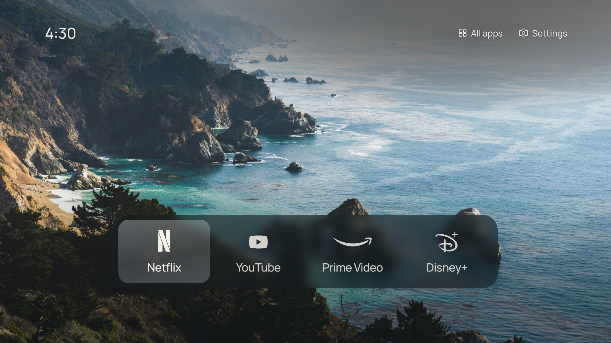

# Mi Tele (cuarto)

Pantalla de inicio limpia, sin anuncios, para la Samsung **UN65AU7000FXZX** del cuarto. Una foto, la hora y tus apps, manejada con el control remoto.



Basada en [CleanFrame](https://github.com/nthnclrk/CleanFrame) de Nathan Clark (licencia MIT), adaptada a este televisor:

| Cambio | Por qué |
| --- | --- |
| `required_version="6.0"` en `app/config.xml` | La AU7000 (2021) usa Tizen 6.0; el original pedía 6.5 y el TV lo rechazaría |
| Identidad propia `TeleCuarto.CleanHome`, nombre "Mi Tele" | No se debe reutilizar la identidad del autor original |
| Apps de inicio: Netflix, YouTube, Prime Video, Disney+ | Tus apps. Twitch y Gravity Player se agregan desde el TV (ver guía, paso 6) |
| Sin botón de Art Mode | Esta tele no es una Frame y no tiene Art Mode |
| Perfil de firma `TeleCuarto` en `scripts/package.py` | Tu propio certificado de Samsung |

**No cambia el sistema operativo del TV.** Es una app que instalas en modo desarrollador y abres en lugar del inicio de Samsung. Úsala bajo tu propio riesgo.

## Instalar en el TV

Sigue la [guía de instalación en español](docs/guia-instalacion.md). Necesitas una computadora en la misma red Wi-Fi que el TV y una cuenta Samsung gratuita.

## Probar en la computadora

Requiere Node.js 22+ y Python 3.10+.

```sh
npm ci
npm run dev:public
```

Abre [localhost:4795/home/](http://localhost:4795/home/) y usa las flechas, Enter y Escape.

## Revisiones

```sh
npm run check
CLEANFRAME_PUBLIC_FONTS=1 npm run check:browser   # CHROMIUM_PATH=... para usar un Chromium ya instalado
npm run export:public                              # crea dist/CleanFrame-public-unsigned.wgt
```

## Licencia y créditos

Código original de CleanFrame bajo [licencia MIT](LICENSE). Fuentes, fotos y logotipos conservan sus propios términos: ver [THIRD_PARTY_NOTICES.md](THIRD_PARTY_NOTICES.md). Sin relación con Samsung ni con los servicios de streaming. La documentación en inglés de `docs/` describe el TV del autor original y se conserva como referencia; `scripts/native-home/` es para ese TV y **no** debe usarse en esta tele.
